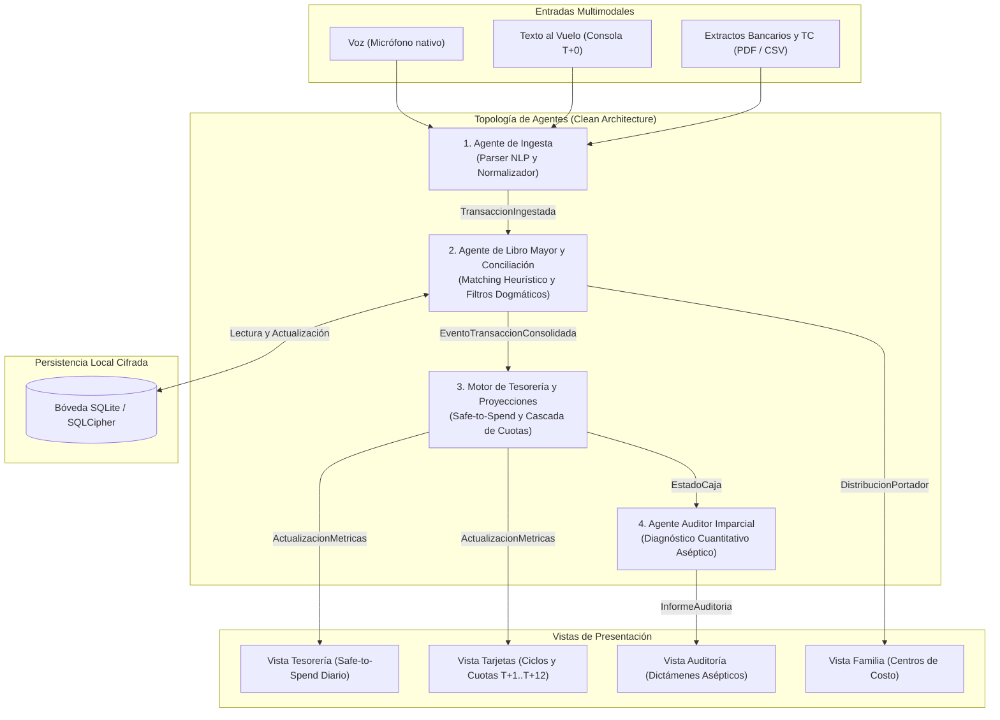

# Topología y Especificación de Agentes: BibliaFinanciera

Este documento define la arquitectura, contratos, responsabilidades y lógica de procesamiento de la **Topología de Agentes** del sistema *BibliaFinanciera*, bajo los principios de **Clean Architecture** (Arquitectura Limpia) y con modelado de datos estrictamente en castellano.

---

## 1. Visión General de la Topología

El sistema opera con cuatro agentes desacoplados que interactúan a través de un bus de eventos y un repositorio de datos centralizado, local y cifrado (*SQLCipher*).



---

## 2. Estrategia de Costo Cero para Modelos de Lenguaje (Sin API Keys de Pago)

Para garantizar la viabilidad económica y erradicar cualquier costo recurrente de API:
1. **Lógica Central Determinística en Dispositivo (100% Gratuito y Offline)**:
   - El **Matching Heurístico**, la **Detección de Transferencias Neutras**, el **Rescate de Desahorro**, la **Cascada de Cuotas** y el **Safe-to-Spend** se ejecutan en código nativo (TypeScript/JavaScript) dentro del dispositivo móvil sin invocar ningún servicio externo.
2. **Reconocimiento de Voz Nativo**:
   - Se utiliza la API nativa del dispositivo (`Android SpeechRecognizer` / `Web Speech API`) que transcribe audio a texto en el propio teléfono sin costo de red.
3. **Parser NLP Híbrido**:
   - **Capa Primaria**: Expresiones regulares y gramáticas formales capaces de extraer montos, comercios y medios de pago de entradas comunes (ej.: *"18500 nafta santander"*).
   - **Capa Secundaria Opcional**: Uso del **Free Tier de Google Gemini** (15 RPM / 1.500 solicitudes diarias a costo \$0) para casos ambiguos, sin incurrir en planes de pago ni tarjetas de crédito.

---

## 3. Especificación Detallada de los Agentes

### Agente 1: Agente de Ingesta (NLP y Multimodal)

* **Propósito**: Recibir entradas no estructuradas (texto rápido $T+0$, transcripción de voz nativa, extractos en formato CSV o PDF de bancos y tarjetas) y emitir estructuras tipadas validadas.
* **Capa Arquitectónica**: `Infraestructura` / `Servicios de Ingesta`.
* **Fuentes de Datos Soportadas**:
  - Entradas manuales de texto y voz del Titular.
  - Resúmenes de Tarjetas de Crédito: **Visa, Mastercard, American Express, Tarjeta Tuya, Tarjeta Mercado Pago**.
  - Extractos de Cuentas: **Santander, Banco del Chaco, Billeteras Virtuales**.

#### Contrato de Salida: `TransaccionIngestada` (JSON Schema)
```json
{
  "$schema": "http://json-schema.org/draft-07/schema#",
  "title": "TransaccionIngestada",
  "type": "object",
  "properties": {
    "entrada_cruda": { "type": "string" },
    "accion_detectada": {
      "type": "string",
      "enum": [
        "GASTO_UNICO",
        "COMPRA_EN_CUOTAS",
        "TRANSFERENCIA_INTERNA",
        "OPERACION_DIVISAS",
        "RECUPERO_PRESTAMO",
        "EXTRACCION_CAJERO"
      ]
    },
    "monto": { "type": "number", "minimum": 0 },
    "moneda": { "type": "string", "enum": ["ARS", "USD"] },
    "medio_pago": {
      "type": "string",
      "enum": ["TARJETA_CREDITO", "TARJETA_DEBITO", "TRANSFERENCIA", "EFECTIVO"]
    },
    "indicio_cuenta": { "type": "string" },
    "indicio_miembro_familia": {
      "type": "string",
      "enum": ["TITULAR", "CONYUGE", "HIJA_1", "HIJA_2", "NO_ESPECIFICADO"]
    },
    "cantidad_cuotas": { "type": "integer", "default": 1 },
    "comercio": { "type": "string" },
    "categoria_inferida": { "type": "string" },
    "rigidez_inferida": {
      "type": "string",
      "enum": ["INFLEXIBLE", "OPERATIVO_ELASTICO", "DISCRECIONAL"]
    }
  },
  "required": ["accion_detectada", "monto", "moneda", "medio_pago", "rigidez_inferida"]
}
```

---

### Agente 2: Agente de Libro Mayor y Conciliación

* **Propósito**: Ejecutar las reglas dogmáticas del sistema sobre el libro mayor unificado, conciliar transacciones provisorias ($T+0$) contra resúmenes bancarios/tarjetas, y aplicar filtros determinísticos de desahorro y transferencias neutras.
* **Capa Arquitectónica**: `Dominio` / `Casos de Uso`.

#### 1. Algoritmo de Matching Heurístico de Extractos
Para cada línea procesada de un extracto oficial (banco o tarjeta), se busca en el libro mayor una transacción con estado `PROVISORIO` calculando el puntaje de coincidencia:

$$\text{PuntajeConciliacion} = w_1 \cdot \text{Igualdad}(\text{monto}) + w_2 \cdot \text{DiferenciaDias}(\Delta t \le 4) + w_3 \cdot \text{SimilitudTexto}(\text{comercio}) + w_4 \cdot \text{DigitosTarjeta}$$

Donde los pesos configurados son:
- $w_1 = 0.40$ (Monto exacto)
- $w_2 = 0.20$ (Ventana temporal $\le 4$ días por diferimiento de compensación)
- $w_3 = 0.25$ (Distancia Levenshtein normalizada contra tabla de alias de comercios)
- $w_4 = 0.15$ (Coincidencia con los últimos 4 dígitos del plástico)

**Criterios de Acción:**
* **Si $\text{PuntajeConciliacion} \ge 0.85$**: La transacción pasa a estado `CONFIRMADO`, adoptando la fecha de compensación oficial pero reteniendo la categorización y el miembro familiar asignado en la carga original $T+0$.
* **Si $\text{PuntajeConciliacion} < 0.85$**: Se inserta un nuevo registro con estado `CONFIRMADO`. El miembro familiar y la categoría se infieren a partir de:
  1. Los 4 dígitos de la tarjeta (si corresponde a una extensión conocida).
  2. El historial previo de transacciones con dicho comercio.

#### 2. Regla Dogmática: Transferencias Neutras
Al procesar una transferencia saliente o entrante, se comprueba si el CBU, CVU o Alias receptor/emisor pertenece a la lista blanca de `identificadores_cuenta` de las cuentas propias registradas:
* Si coincide: Se clasifica como `TRANSFERENCIA_INTERNA`.
* **Efecto de Caja**: El impacto consolidado en el patrimonio líquido es estrictamente cero ($+M - M = 0$).

#### 3. Regla Dogmática: Intercepción de Desahorro
Si se registra una entrada de pesos en una cuenta bancaria asociada cronológicamente a un egreso en la cuenta en dólares (o liquidación de activos de reserva para cubrir gastos operativos):
* La transacción se tipifica irrevocablemente como `RESCATE_DESAHORRO`.
* **Efecto Contable**: Se excluye de los `ingresos_genuinos` del mes y se acumula en la métrica crítica de *Déficit Operativo Cubierto con Capital*.

#### 4. Regla Dogmática: Amortización de Caja Negra (Efectivo)
Cuando se detecta una extracción en cajero automático (`EXTRACCION_CAJERO`):
* Se registra un débito en la cuenta bancaria y un crédito en la cuenta de efectivo (`CAJA_EFECTIVO`).
* Inmediatamente, la transacción se amortiza al 100% como gasto operativo bajo la categoría `EFECTIVO_AMORTIZADO`. No se exige al usuario cargar micro-tickets diarios de billetes.

---

### Agente 3: Motor de Tesorería y Proyecciones

* **Propósito**: Calcular en tiempo real la liquidez real disponible, proyectar la carga futura de cuotas y establecer el límite matemático de gasto seguro diario.
* **Capa Arquitectónica**: `Dominio` / `Servicios de Dominio`.

#### 1. Ecuación del Safe-to-Spend Diario (Gasto Seguro Diario)
Determina cuánto dinero puede gastar la familia por día sin comprometer el pago de los resúmenes de tarjetas ni agotar el colchón mínimo de seguridad:

$$\text{Safe-to-Spend}_{\text{hoy}} = \frac{S_{\text{liquido}} - G_{\text{inflexibles}} - T_{\text{tarjetas}} - R_{\text{contingencia}}}{D_{\text{restantes}}}$$

Donde:
* $S_{\text{liquido}}$: Sumatoria de saldos disponibles en cuentas bancarias corrientes/ahorro y billeteras líquidas (excluyendo cuentas bloqueadas y cuentas en USD reservadas).
* $G_{\text{inflexibles}}$: Compromisos fijos obligatorios pendientes de pago en el ciclo actual (alquiler, expensas, colegios, servicios esenciales).
* $T_{\text{tarjetas}}$: Saldo total devengado en los ciclos abiertos de todas las tarjetas de crédito (compras provisorias $T+0$ + cuotas facturadas del mes).
* $R_{\text{contingencia}}$: Piso o umbral de reserva intocable fijado por el Titular.
* $D_{\text{restantes}}$: Días calendario faltantes para la próxima fecha prevista de ingreso genuino (ej. fecha de cobro de haberes u honorarios).

#### 2. Cascada de Cuotas y Ratio de Endeudamiento
Proyecta para los meses $T+1, T+2, \dots, T+12$ la deuda ya comprometida en cuotas futuras en todas las tarjetas (Visa, Mastercard, Amex, Tuya, Mercado Pago):

$$\text{RatioEndeudamiento}_{m} = \frac{\sum \text{CuotasComprometidas}_{m}}{\text{IngresoBaseEstimado}}$$

* **Regla de Bloqueo Preventivo**: Si $\text{RatioEndeudamiento}_{m} > 0.35$ (35% del ingreso base), el simulador *What-If* marca la proyección en alerta roja y bloquea la recomendación de nuevas compras financiadas.

---

### Agente 4: Agente Auditor Imparcial

* **Propósito**: Evaluar cuantitativamente la marcha económica familiar sin sesgos subjetivos ni juicios de valor. Traduce la realidad numérica en un diagnóstico accionable.
* **Capa Arquitectónica**: `Aplicación` / `Servicios de Auditoría`.
* **Frecuencia de Ejecución**: Semanal y tras el procesamiento de resúmenes mensuales.

#### Estructura del Informe de Auditoría (Directiva Cuantitativa)
El reporte emitido por el Auditor sigue una plantilla estrictamente objetiva:

1. **Balance de Caja Real**:
   - Ingresos Genuinos Netos vs. Gastos Totales Devengados ($T+0$).
   - Resultado Operativo: `Superávit (+)` o `Déficit (-)`.
2. **Registro de Desahorro**:
   - Monto exacto de reservas (USD o inversiones) consumidas en el período para compensar déficit operativo.
3. **Distribución por Centros de Costo (Familia)**:
   - Desglose porcentual y nominal de consumos por miembro:
     - Titular
     - Cónyuge
     - Hija 1 (Verificación contra categorías autorizadas: Salud, Farmacia, Seguros)
     - Hija 2 (Velocidad de consumo o *Burn-Rate* respecto a días transcurridos)
4. **Directiva Matemática**:
   - Nuevo valor diario del $\text{Safe-to-Spend}$ para el resto del ciclo para garantizar cierre en equilibrio.

---

## 4. Esquema de Entidades en Castellano (Clean Architecture)

```
┌─────────────────────────────────────────────────────────────┐
│                           CUENTAS                           │
├─────────────────────────────────────────────────────────────┤
│ id: UUID (PK)                                               │
│ nombre: VARCHAR                                             │
│ tipo_cuenta: ENUM (CORRIENTE, AHORRO, BILLETERA, EFECTIVO) │
│ moneda: VARCHAR (ARS, USD)                                  │
│ saldo_actual: DECIMAL                                       │
│ identificadores_cuenta: JSON (CBUs, CVUs, Alias, CUITs)     │
└──────────────────────────────┬──────────────────────────────┘
                               │ 1
                               │
                               │ N
┌──────────────────────────────▼──────────────────────────────┐
│                      TARJETAS_CREDITO                       │
├─────────────────────────────────────────────────────────────┤
│ id: UUID (PK)                                               │
│ banco_emisor: VARCHAR                                       │
│ marca_tarjeta: ENUM (VISA, MASTERCARD, CABAL, AMEX, TUYA, MP)│
│ ultimos_cuatro_digitos: CHAR(4)                             │
│ dia_cierre_resumen: INTEGER                                 │
│ dia_vencimiento_pago: INTEGER                               │
│ id_cuenta_liquidacion: UUID (FK -> cuentas.id)             │
└──────────────────────────────┬──────────────────────────────┘
                               │ 1
                               │
                               │ N
┌──────────────────────────────▼──────────────────────────────┐
│                        TRANSACCIONES                        │
├─────────────────────────────────────────────────────────────┤
│ id: UUID (PK)                                               │
│ id_cuenta_origen: UUID (FK -> cuentas.id, NULLABLE)         │
│ id_tarjeta_credito: UUID (FK -> tarjetas_credito.id, NULL)  │
│ id_miembro_familia: UUID (FK -> miembros_familia.id)        │
│ fecha_transaccion: DATETIME                                 │
│ fecha_compensacion: DATETIME (NULLABLE)                     │
│ monto: DECIMAL                                              │
│ moneda: VARCHAR (ARS, USD)                                  │
│ tipo_cambio: DECIMAL (NULLABLE)                             │
│ tipo_transaccion: ENUM (GASTO, INGRESO_GENUINO,             │
│                         TRANSFERENCIA_INTERNA,              │
│                         RECUPERO_CAPITAL,                   │
│                         RESCATE_DESAHORRO)                  │
│ nivel_rigidez: ENUM (INFLEXIBLE, OPERATIVO_ELASTICO,        │
│                      DISCRECIONAL)                          │
│ categoria: VARCHAR                                          │
│ comercio: VARCHAR                                           │
│ estado: ENUM (PROVISORIO, CONFIRMADO)                       │
│ hash_conciliacion: VARCHAR (INDEX)                          │
└─────────────────────────────────────────────────────────────┘
```

---

## 5. Próximos Pasos de Implementación
1. Inicialización de la estructura de carpetas siguiendo Clean Architecture (`src/dominio`, `src/aplicacion`, `src/infraestructura`, `src/presentacion`).
2. Implementación de los repositorios SQLite cifrados y entidades en TypeScript.
3. Codificación de las funciones determinísticas de los Agentes 2 y 3 (Matching Heurístico y Ecuación Safe-to-Spend).
4. Implementación de la capa de interfaz móvil con navegación por pestañas para las 4 vistas maestras.

# Directivas de Idioma y Razonamiento

- **Proceso de pensamiento (Chain of Thought):** Todo tu razonamiento interno, análisis preliminar, formulación de hipótesis y reflexiones DEBEN realizarse estrictamente en idioma castellano.
- **Acciones y resúmenes de herramientas:** Al analizar archivos o ejecutar comandos, titula y describe los pasos en castellano (por ejemplo: "Analizando esquemas", "Consultando base de datos").
- **Respuestas y artefactos:** Toda explicación, respuesta en chat y archivo generado (`implementation_plan.md`, `task.md`) debe redactarse íntegramente en castellano.